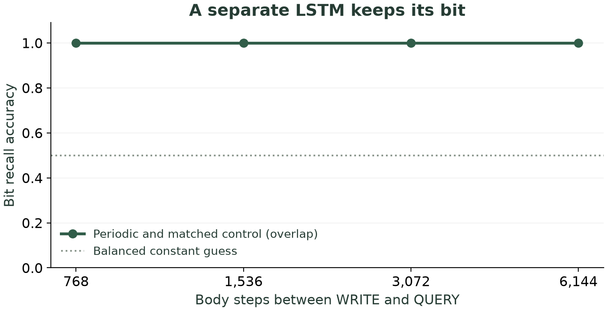

If a model sees the same pattern again and again, its job ought to get easier. There is less new information to process, and a good guess is often simply “more of the same.”

On a temporal graph task, we found something less reassuring: a trained recurrent model became worse at predicting a graph as that graph kept repeating. This led to the question behind our [representation collapse project](https://github.com/MehrabHamidi99/representation_collapse): **does repetition gradually erase information the model needs?**

The results so far make that question more interesting. We reproduced a clear prediction failure. But when we gave a separate LSTM a direct memory task, it remembered its bit perfectly through thousands of repeated inputs. A low-dimensional state representation appeared alongside successful memory.

This is a research update, written in November from experiments verified in October 2026. The evidence is still narrow: one trained seed per setting, synthetic tasks, and no established general mechanism of harmful collapse.

## A repeating graph that becomes harder to predict

The starting point was [T-GRAB](https://arxiv.org/abs/2507.10183), our benchmark for testing temporal reasoning in graph models. Think of two graph snapshots, A and B, alternating in blocks:

`AAAA…AAAA BBBB…BBBB AAAA…AAAA …`

The model predicts the next graph from the sequence it has seen. In the setting we reconstructed, each block lasts 32 steps. A GC-LSTM combines graph processing with an LSTM's recurrent memory.

After a 200-epoch training run, validation selected the checkpoint at epoch 160. Within the repeated blocks, its mean F1 fell from **0.959 in the early window to 0.819 in the late window**. F1 summarizes how well predicted edges match the true edges. That 14.05-point drop reproduces the qualitative behavior that motivated us in Figure 10 of T-GRAB. It is one corrected model reconstruction, rather than a reproduction of every method and seed in the original figure.

The distinction between *within a block* and *across cycles* matters. The pattern of errors was almost the same across successive cycles. We did not observe an endlessly worsening model each time A and B returned.

Next, we kept the checkpoint fixed and stretched the blocks. We tested 8, 16, 32, 64, 128 and 256 repetitions, using both A-first and B-first sequences. Each run covered 2,048 prediction steps.

*One checkpoint and one graph realization; curves average the two starting orders. Persistence predicts the last observed graph. Its undefined first prediction is excluded, while the model's first prediction is included.*

Mean F1 fell from **0.889 at 32 repetitions to 0.657 at 256**. Meanwhile, the simple persistence baseline improved from about 0.969 to 0.997: longer constant blocks mean fewer occasions when copying the last graph is wrong.

So there is a real prediction problem to explain. The state measurements, however, do not give a simple collapse story. In most of this sweep, the effective dimension of the complete hidden-plus-cell state increased from the early window to the late window, even as its total variance decreased. The size of the within-block performance drop was also not strictly monotone across the full sweep.

One plausible explanation is a learned expectation about when the graph should change. A model trained on 32-step blocks may start anticipating a transition that never arrives. Changing block length also changes the temporal distribution relative to training. We have not yet separated those possibilities from information loss.

More fundamentally, **predicting the repeated graph does not require remembering a distant event**. The latest graph already gives a strong answer. To ask whether repetition destroys old information, we needed a task that actually requires it.

## Write a bit, wait, then ask for it

The memory experiment has three parts:

1. **WRITE:** show the network a zero or a one.
2. **BODY:** feed it a sequence of distractor symbols.
3. **QUERY:** ask which bit it saw at the start.

The bit is absent from the body and query inputs. The LSTM has to carry it in its recurrent state.

We compare a periodic body, made by repeating one motif, with a varying-order control of the same length. The two bodies match symbol counts, adjacent transitions, run lengths and ending context. They still differ in higher-order structure and predictability; “matched” does not mean identical in every statistical property.

Before testing longer delays, we require the model to learn the task. This seed passed all three planned competence checks. We then froze its weights and evaluated new panels with both bit values and both body types.

It recalled the bit correctly in every tested episode through 384 body steps. A separately planned extension pushed the delay to **6,144 body steps**.

*A separate, frozen one-bit LSTM. The two curves overlap exactly. The extension also tested longer symbol dwell at the same total body length, with the same perfect recall.*

Across all six extension conditions—**12,288 episode rows**—both arms scored 100%. Replacing the complete hidden and cell state with the opposite-bit donor's state made the model give that donor's answer. Zeroing the state reduced accuracy to 50%. Those checks establish that the answer depends on retained state; they do not identify a particular memory mechanism.

This result is limited to one seed and one bit. It does not tell us how many independent items the model can store. But it is a useful negative finding: repetition did not erase the required bit over the horizons we tested. The different graph and memory tasks should not be treated as a controlled comparison of architectures.

## What the theory helps us distinguish

The theoretical work has been most useful for catching tempting but invalid conclusions. These are established ideas and elementary derivations collected in our [theory notes](https://github.com/MehrabHamidi99/representation_collapse/blob/b45b354d25731e773aea7dc88dc10f2c877fbe16/docs/October/2026-10-26/local/auto-research/theory-propositions.md), rather than a claim of a new general collapse theorem.

### Low dimension can be enough

Imagine two well-separated points: one represents zero, the other one. Their centered covariance has rank one. That is all the geometry a one-bit task needs.

More generally, an exactly periodic trajectory visiting only P distinct states has centered covariance rank at most P−1, however large the network is. Repeated observations alone can therefore make a state cloud look low-dimensional.

Our one-bit LSTM had a pooled hidden-plus-cell participation ratio close to one. Participation ratio measures how broadly variance is spread across directions. Recall was nevertheless perfect, and the measured separation between opposite-cue states grew. The state summaries came from the worker; the compact audits checked their provenance, but did not independently recompute the saved binary state arrays.

There is an opposite trap, too. Shrinking every state coordinate by the same factor leaves normalized participation ratio unchanged. Yet, against a fixed noise floor, the stored signal can become harder to recover. We need absolute scale, task recovery and geometry together.

### An output can change without the stored difference disappearing

Consider a simple noiseless recurrence:

`s[t+1] = A s[t] + B x[t] + b`

Here the same matrix A updates the state at every step. Start with two different written cues, then pass both through the same distractor body. After H steps, the difference between their states is:

`difference after H steps = A^H × initial difference`

At equal H, changing the order of the body inputs changes a common offset, but not that cue-dependent difference. A fixed readout can still make different errors because the whole representation has shifted relative to its decision boundary.

This is a useful null model. It tells us to distinguish a damaged memory signal from a readout operating in the wrong region. It is not a theorem that LSTM gates behave linearly, nor does it guarantee that either input order preserves memory.

### Stable memory can involve contraction

For a finite set of labels, a system can store each label in a separate stable state or cycle. Small disturbances can shrink around each state while the label identities remain distinct. Local contraction can then help protect memory. We have not demonstrated that the trained one-bit LSTM uses this mechanism.

Exact analog memory is more demanding. Suppose a smooth encoder stores d continuously varying quantities, a smooth decoder recovers them exactly, and a common return map leaves every encoded state fixed. Differentiating those conditions shows that the encoding needs d independent directions, and the return map must preserve those directions with eigenvalue one. This statement relies on exact, smooth, invariant storage. It does not apply directly to a finite set of labels or approximate finite-horizon recall.

That distinction is why contraction alone cannot settle the memory question.

## Where Floquet analysis fits

Floquet analysis studies how small disturbances evolve around a periodic trajectory. For a recurrent model, we multiply the step Jacobians in time order to describe one full cycle.

But a repeating input does not guarantee that the complete internal state repeats. An LSTM's state includes both its hidden state and its cell state; a graph model also carries the node structure of that state. We must check the trajectory before treating the product as a periodic return map. Without that check, it remains a finite-time sensitivity calculation.

**These trained-model experiments have not yet measured a Floquet spectrum.** They establish behavioral results and state diagnostics. The dynamical explanation is still work ahead.

## The next experiments

The immediate priority is to move from one bit to **several independently written bits**, with the query address revealed only after the distractor body. We should first verify that every address is reliably learned, then vary memory load and repetition at fixed weights. That starts to measure an operational memory limit.

For the graph model, we need checkpoints trained at several block lengths and with variable timing. If the failure timescale moves with the training schedule, that would support the learned-timing explanation. Multiple independent training seeds will tell us whether either result is typical.

Finally, we want to connect behavior to state dynamics: test whether alternative readouts recover apparently lost information, perturb candidate memory directions alongside matched shams, and measure complete-state sensitivity. Only then should we carry the same controlled questions into other modalities.

The project began with a suspicion that repetition collapses useful representations. The results so far have made the target more precise: **when does repetition remove information the task needs, and when does it leave a compact, useful memory intact?** Both outcomes belong in the explanation.

## Results and code

The [project repository](https://github.com/MehrabHamidi99/representation_collapse) contains the code, protocols and evidence. The detailed reports cover the [GC-LSTM reconstruction](https://github.com/MehrabHamidi99/representation_collapse/blob/b45b354d25731e773aea7dc88dc10f2c877fbe16/docs/October/2026-10-20/local/auto-research/figure10-gclstm-longfit-results-2026-10-20.md), [graph repetition sweep](https://github.com/MehrabHamidi99/representation_collapse/blob/b45b354d25731e773aea7dc88dc10f2c877fbe16/docs/October/2026-10-20/local/auto-research/repetition-dwell-results-2026-10-20.md), and [long-horizon one-bit experiment](https://github.com/MehrabHamidi99/representation_collapse/blob/b45b354d25731e773aea7dc88dc10f2c877fbe16/docs/October/2026-10-23/local/auto-research/onebit-long-horizon-results-2026-10-23.md). Numerical checks and successful jobs support those specific findings; they do not establish universal collapse.
