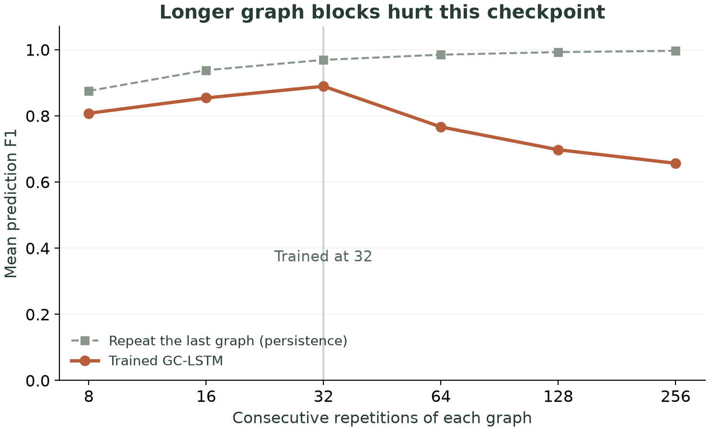

A model sees the same pattern again and again. Its internal activity settles into a rhythm. Some directions in its state shrink. Has it forgotten something?

That is the question behind our [representation collapse project](https://github.com/MehrabHamidi99/representation_collapse). It started with temporal graph models that become worse at predicting a graph while that graph keeps repeating. Floquet theory seemed a natural way to investigate: study the internal dynamics over one cycle, then ask what survives repeated cycles.

The theory gives us a precise language for that question. It also exposes a trap. **A shrinking perturbation, a low-dimensional state cloud, and the loss of useful memory are three different observations.** They can occur together, but none automatically establishes the others.

The evidence is mixed. We reproduced a graph prediction failure, but separate LSTMs retain one bit through 6,144 distractor steps and four bits through 1,536. The dynamical evidence remains incomplete. Together, these results narrow the question: what distinguishes a recurrent model that loses a useful memory from one that preserves it through repetition?

## Start with one complete cycle

Write a recurrent model as:

```text
s[t+1] = F(s[t], x[t])
```

The state `s` must contain everything carried between updates. For an LSTM, that includes both hidden and cell states. For a graph LSTM, it includes those states for all nodes, in a fixed ordering. Looking at the hidden vector alone can miss information carried elsewhere.

Now suppose the input repeats every `P` steps, and the complete state follows a periodic orbit of that same period. At each step, a Jacobian `J[t]` describes how a small change in state affects the next state, while the input and weights remain fixed. The derivative of one full cycle is the ordered product:

```text
M = J[P−1] ··· J[1] J[0]
```

The earliest update acts first, on the right. This matrix is the discrete *monodromy matrix*. Its eigenvalues, usually written `μ`, are the Floquet multipliers. They describe local stability of the periodic orbit.

There is an essential qualification: **periodic input alone does not make the hidden trajectory or its Jacobians periodic**. A network may keep drifting, have a response with a longer period, or follow different trajectories depending on its history. We need to check that the complete state returns, and that the step derivatives repeat. If the state returns only after two input cycles, that longer period is the relevant one. Without verified periodicity, the same Jacobian product remains useful, but we call it a finite-time propagator.

Period length also matters when comparing numbers. Following two cycles instead of one squares the multipliers, even though the dynamics have not changed. A multiplier of 0.8 over one cycle becomes 0.64 over two. To compare attenuation across different periods, use the rate per update:

```text
rate = log(|μ|) / P
```

Reporting a smaller multiplier without its time unit can therefore create a misleading impression of stronger contraction.

## A contracting multiplier is not a forgetting verdict

For a small perturbation along an eigenvector, the linearized dynamics scale it by `μ` per cycle. After `k` cycles, its magnitude scales by `|μ|^k`. When all multipliers have magnitude below one, a smooth periodic orbit is locally attracting. Values above one indicate unstable directions; values exactly on the unit circle require more care.

That is a statement about small perturbations near a particular orbit. It does not tell us which perturbations encode the task, whether two different memories occupy different orbits, or whether a decoder can still read a weakened signal.

It also describes long-run local behavior more directly than short-run amplification. In a *nonnormal* system, directions can interact so that a disturbance grows temporarily even when all eigenvalues lie inside the unit circle. Singular values of the finite-time product tell us about that amplification. Eigenvalues and singular values answer related but different questions.

A tiny example helps. Consider:

```text
s[t+1] = 0.5 s[t] + x[t]
```

Let the input alternate in the pattern AABB, with A equal to zero and B equal to one. The system approaches a nonconstant, four-step periodic response. Yet its one-cycle multiplier is simply:

```text
μ = 0.5⁴ = 1/16
```

Old state differences disappear while a visible rhythm continues, driven by the input. There is no requirement for a neutral multiplier of one just because the activity repeats. The external sequence supplies the timing. This is an analytic control, not a trained-network result.

## How we would measure the largest modes

“Measure the largest eigenvalue” sounds simple, but two different quantities matter:

```text
spectral radius:       ρ(M) = max |μ|
largest singular value: σ_max(M) = max ||Mv|| / ||v||, over v ≠ 0
```

The spectral radius governs asymptotic growth in the linearized cycle dynamics. The largest singular value gives the largest possible Euclidean amplification in one cycle. Covariance eigenvalues measure how state variation is distributed; they are neither of these dynamical quantities.

For a concrete analytic example, take:

```text
M = [[0.8, 4.0],
     [0.0, 0.8]]
```

Both eigenvalues are 0.8, so the spectral radius is 0.8. Yet the largest singular value is approximately **4.154**. Some perturbations initially grow by more than fourfold before eventually decaying. A negative asymptotic rate therefore does not mean that every cycle, phase or perturbation shrinks monotonically. This example describes a linear map, not a measured network.

For a large graph LSTM, explicitly storing the full matrix may be impractical. We can instead implement its action on a vector. Starting from a perturbation of **all hidden and cell coordinates across all nodes**, apply a Jacobian–vector product at each saved trajectory step in chronological order. That gives `Mv` without materializing `M`. An Arnoldi iteration can use this operation to estimate eigenvalues of large magnitude and their eigenvectors.

The transpose action uses vector–Jacobian products through the same trajectory in reverse order. Combining the two actions lets an iterative method estimate the largest eigenvalue of `MᵀM`; its square root is the largest singular value. Both computations require fixed weights, replayed inputs and the same complete-state definition. Calling the eigenvalues Floquet multipliers additionally requires the orbit and period checks described above.

Our planned checks are deliberately redundant: match dense products on small cases, compare propagated perturbations against finite differences at decreasing amplitudes, and inspect each candidate eigenpair's relative residual—the size of `Mv−μv` compared with the sizes of `Mv` and `μv`. Repeat with different starting vectors, restart settings, Krylov basis sizes and precision. Compare cycle phases too: nonzero Floquet eigenvalues should agree for an exact periodic orbit, while singular values can depend on phase.

A small residual supports a particular approximate eigenpair; it does not prove that no larger eigenvalue was missed. One Arnoldi run or a partial spectrum cannot certify the true global spectral radius. A conclusion that the orbit is locally attracting requires evidence that the **full** spectral radius is below one, with adequate convergence or a suitable bound.

Even then, the leading mode need not carry the remembered variable. We must also propagate cue-related directions or compare finite cue differences and task recovery. This [measurement programme](https://github.com/MehrabHamidi99/representation_collapse/blob/b45b354d25731e773aea7dc88dc10f2c877fbe16/docs/October/2026-10-26/local/auto-research/research-program.md) remains pending for the reconstructed trained GC-LSTM. The six recovered values discussed below are not verified leading modes.

## Why analog memory and a remembered bit differ

Suppose we want to store a continuously varying quantity exactly, rather than choose between a few labels. There is a useful classical constraint here, closely related to [Seung's work on continuous attractors](https://pmc.ncbi.nlm.nih.gov/articles/PMC24094/).

Let a smooth encoder `E(u)` represent `d` continuous quantities over an open region of values, and let a smooth decoder `g` recover them exactly. If a common return map `R` leaves every encoded state fixed, then:

```text
g(E(u)) = u          R(E(u)) = E(u)
```

Differentiating gives:

```text
Dg(E(u)) DE(u) = I   DR(E(u)) DE(u) = DE(u)
```

The first identity requires `d` independent encoding directions. The second says that the return map preserves each of them: it has at least `d` independent eigenvectors with eigenvalue +1.

The assumptions do real work. This is exact, smooth, invariant memory of a continuum. It is not a bound on participation ratio, and it does not directly describe approximate recall over a finite delay.

A bit can be stored differently. Imagine two separate stable states, one for zero and one for one. Small disturbances shrink around each state, while the two states remain distinguishable. The same idea extends to separate attracting cycles under periodic input. Every local multiplier can be below one and the label can still survive.

This possibility is already present in prior research: [Pals, Macke and Barak](https://pmc.ncbi.nlm.nih.gov/articles/PMC10868787/) studied memory-selective, phase-locked cycles in trained recurrent networks. Our use of this distinction is a measurement guide, not a claim to have discovered attractor memory. We have not yet shown that our trained one-bit LSTM uses this mechanism.

## When should input order matter?

Before interpreting an ordering effect in a gated network, it helps to know a case where no such memory effect is possible. Consider a noiseless affine recurrence with the same state matrix at every step:

```text
s[t+1] = A s[t] + B x[t] + b
```

Start with two different written cues, then feed both the same body. After `H` steps, their state difference is `A^H` times the initial difference. At equal duration, changing the body's order changes a common offset, but not this cue-dependent difference.

A fixed readout can still make different errors: the common offset may move the states across its decision boundary. So an ordering-dependent error does not, by itself, prove that the stored distinction has been destroyed.

A related null holds when each symbol has its own affine transition matrix and those matrices commute. Matching symbol counts then matches the product acting on cue differences. This concerns the noiseless cue signal; intermediate process noise can still accumulate differently across orders.

Noncommuting matrices can produce different ordered products, but that is only an opportunity for a task effect. The products might differ entirely outside the directions that carry the required cue. Our target is therefore more specific: **does the periodic order damage task-relevant distinctions more than a same-length control does?** The [theory notes](https://github.com/MehrabHamidi99/representation_collapse/blob/b45b354d25731e773aea7dc88dc10f2c877fbe16/docs/October/2026-10-26/local/auto-research/theory-propositions.md) collect these established results, elementary derivations and open questions.

## Dimension can mislead in both directions

Two distinct points can encode a bit perfectly. Their centered covariance has rank one. More generally, a periodic orbit visiting only `P` distinct states has centered covariance rank at most `P−1`, however large the network is. A low-dimensional picture can reflect the sampling geometry rather than lost information.

Participation ratio summarizes how broadly covariance variance is spread across directions. It is useful, but it ignores uniform changes in scale. Shrink every coordinate by the same factor and participation ratio stays unchanged, even though recovering the signal against a fixed noise floor may become harder.

There is a stronger warning in our [analytic folding counterexample](https://github.com/MehrabHamidi99/representation_collapse/blob/b45b354d25731e773aea7dc88dc10f2c877fbe16/docs/October/2026-10-15/local/auto-research/folding-memory-counterexample-2026-10-15.md). Encode a balanced bit as the sign of `x`, with its magnitude chosen independently. A deterministic update squares `x`, then applies a fixed centering and rescaling. Positive and negative inputs with the same magnitude become identical: the bit is irreversibly lost.

The example chooses the magnitude distribution and scale so that the complete two-dimensional state's covariance is exactly unchanged. An independent nuisance coordinate supplies the second dimension. At every realized input state, the one-step Jacobian's singular values are at least one. There is no local contracting direction, yet one bit becomes zero recoverable bits because the map folds two separated branches together.

This is an exact one-update construction, not a recurrent benchmark or Floquet result. It explains why local derivatives alone cannot detect every form of information loss: they compare infinitesimal neighbors, while the lost distinction can lie between distant branches.

These controls have practical value. The project's basic calibration and mechanism suites contain 10 and 36 checks, respectively, covering such issues as product ordering, known spectra, attenuation and retained categorical memory. Passing them validates the measurement code. It supplies no empirical evidence that a trained model collapses.

## What the dynamical evidence actually shows

We recovered older graph-analysis arrays and independently checked their numerical integrity. Six saved eigenvalue magnitudes lie between **0.379784 and 0.407370**, and saved vector norms decrease across prefix files. Those observations are compatible with attenuation in the stored calculation.

But an important defect in interpretation emerged: in each of 19 envelope files, **all 20 stored time rows are byte-identical**. That axis cannot describe 20 changing dynamical states. The inspected source suggests one possible explanation, but the original producer has not been established.

The exact checkpoint, product chronology, state adapter, eigenpair residuals and orbit closure also remain unlinked. Six values are a partial saved spectrum; they cannot certify the full spectrum or its leading modes. The [archive audit](https://github.com/MehrabHamidi99/representation_collapse/blob/b45b354d25731e773aea7dc88dc10f2c877fbe16/docs/October/2026-10-14/local/auto-research/legacy-floquet-array-audit-results-2026-10-14.md) therefore treats these as recovered numerical outputs, not verified Floquet multipliers of a trained periodic orbit.

The early memory pilots offer another caution. An [independent reduction](https://github.com/MehrabHamidi99/representation_collapse/blob/b45b354d25731e773aea7dc88dc10f2c877fbe16/docs/October/2026-10-26/local/auto-research/periodicity-independent-results.md) found all 64 measured 12-step manual tangent gains below one, roughly **0.00417–0.0126**. Paired cue differences became tiny in both forcing arms. Yet all four checkpoints failed their original native-competence gates: they had not reliably learned the required task.

Those products demonstrate local attenuation in the diagnostic calculation. They do not demonstrate that repetition erased a skill the models had acquired. They were finite-time products, not certified monodromy matrices, and both-arm attenuation does not establish an ordering-specific effect. This is why competence comes before a forgetting claim.

## The graph failure is real; its mechanism is open

The behavioral starting point was [T-GRAB](https://arxiv.org/abs/2507.10183), our diagnostic benchmark for temporal graph reasoning. Two snapshots, A and B, alternate in constant blocks. The model predicts the next graph from the sequence it has observed.

We reconstructed a GC-LSTM trained with 32-step blocks. After 200 training epochs, validation selected epoch 160. Mean F1 fell from **0.959 in an early within-block window to 0.819 in a late window**, a 14.05-point drop. That reproduces the qualitative behavior motivating Figure 10, for one corrected model and seed. It is not the full original multi-method, multi-seed reproduction.

The error pattern was almost the same across successive cycles. We observed deterioration within a block, rather than an endlessly worsening model each time A and B returned.

Keeping that checkpoint fixed, we tested block lengths 8, 16, 32, 64, 128 and 256, with both starting orders and 2,048 predictions per condition.

[](/assets/portfolio/repetition-graph.png)

*One checkpoint and one graph realization; curves average A-first and B-first runs. Persistence copies the last graph. Its undefined first prediction is excluded, while the model's first prediction is included.*

Mean F1 fell from **0.889 at length 32 to 0.657 at 256**, while persistence improved from about 0.969 to 0.997. Longer constant blocks give persistence fewer transitions to miss. The learned model has a substantial failure to explain.

The state geometry is mixed. In the reconstructed 32-step task, complete hidden-plus-cell participation ratio declined modestly within each motif, while variance attenuated strongly. In the longer-block sweep, that participation ratio increased early-to-late in every condition through length 128. The within-block performance drop was not strictly monotone either.

Changing block length also changes the temporal distribution relative to training. A model trained on 32-step blocks might anticipate a transition that never arrives. That learned-timing explanation remains plausible. Predicting a repeated graph can be solved from its latest observation, so this task does not directly isolate retention of a distant event.

## Useful memory can survive repetition

The direct memory task separates that issue: **write a bit, present a distractor body, then query the bit**. The bit is absent from all body and query inputs, so an LSTM must carry it in its recurrent state.

We compare periodic repetition of one motif with a varying-order body of equal duration. The arms match symbol counts, adjacent transitions, run lengths and ending context. Higher-order structure and predictability still differ; this is a specified ordering intervention, not a match of every statistic.

The seed passed all three planned competence checks. With weights frozen, it recalled the bit in every tested episode through 384 body steps. A separately planned extension reached **6,144 body steps**.

[](/assets/portfolio/repetition-memory.png)

*One frozen LSTM; the curves overlap exactly. Additional conditions changed symbol dwell at the same total delay and also preserved recall.*

Across the extension's six conditions and **12,288 episode rows**, both arms scored 100%. Complete-state opposite-bit swaps made the model answer with the donor's bit; zeroing the state reduced accuracy to 50%. These checks establish dependence on retained state without identifying its storage mechanism.

Pooled hidden-plus-cell participation ratio was close to one, while opposite-cue state separation grew. Low effective dimension coexisted with useful recall. The worker produced those state summaries; compact audits verified their provenance, but did not independently recompute the saved binary arrays.

This is one trained seed and one bit, not a capacity estimate or proof of stable basins. It is nevertheless a valuable negative result for harmful repetition at the tested horizons. The graph and memory settings are separate experiments, not a controlled architecture comparison.

We then increased the memory load: write 1, 4, 16 or 64 independent bits at once, then recover the full vector after the body. Each load gets a separate seed-0 fit with the same architecture: 69 input channels and an LSTM with 64 hidden units. This is still categorical recall, not a continuous high-dimensional signal or a graph.

The 1-bit and 4-bit fits passed the worker's competence gates. Both recovered the complete vector in **every tested episode through 1,536 distractor steps**, in periodic and matched-control arms. Each fit was tested on ten conditions and 20,480 episode rows, with cue panels reused across conditions. The prespecified periodic-minus-control error contrast was zero. The 16-bit and 64-bit fits failed acquisition gates and stopped before held-out testing; those failures cannot establish repetition-induced forgetting.

[](/assets/portfolio/repetition-multibit.png)

*One trained seed per load. Curves average four forcing-specific, cue-centered covariance summaries per arm; periodic and control curves nearly overlap. Only competent loads appear. No seed-population uncertainty is estimated.*

The four-bit model's complete-state participation ratio increased from about **4.07 immediately after WRITE to 7.93 at 1,536 steps**. A nonlinear encoding of 16 possible cue vectors can have centered covariance rank as high as 15, so a participation ratio above four is not paradoxical. Here useful recall survives while measured dimension grows.

These are exploratory results. An independent reducer checked the raw test arrays and covariance calculations, but validation logits and explicit counts were not saved: competence gates are verified only against their recorded summaries. The [full report](https://github.com/MehrabHamidi99/representation_collapse/blob/d1ad0790bda4b43f7f4bcebc7596e04d4b9a9ef4/docs/November/2026-11-16/mila/report/multibit-discovery-results.md) preserves that limitation and both failed fits. We have not measured a Floquet spectrum or established stable memory basins for these models.

## Finding the boundary of useful memory

The next experiment fills in the load curve at 4, 8, 12, 16, 24, 32, 48 and 64 bits, with a fixed model size, longer acquisition training and three seeds. Each fit must acquire the task before we test forgetting. We will retain raw validation outputs, reload and replay each final checkpoint, and use fresh held-out panels for delays up to 6,144 steps. The aim is to locate a retention-failure boundary, while distinguishing it from a failure to learn in the first place. A later, stronger extension will reveal a query address only after the body, testing access to an item that the model could not select in advance. Continuous-valued cues will test a different memory requirement from a finite set of bit vectors.

For the graph model, training at several block lengths and with variable timing will test whether the failure timescale follows the training schedule. Multiple independent seeds are needed in both settings.

The next dynamical measurements must connect to the task: complete-state Jacobian products, orbit-closure checks, finite-time gains, alternative readouts, and perturbations of proposed memory directions with matched shams. We should examine categorical basin separation alongside local contraction. Native tests in other modalities follow once the same question and controls work here.

Floquet theory gives us a disciplined way to study repeated dynamics. The experiments tell us which parts of that theory are actually relevant. Our goal is to explain **when repetition destroys a task-required distinction, and when it leaves a compact, useful memory intact**. The evidence so far requires room for both.

## Evidence and further reading

The [project repository](https://github.com/MehrabHamidi99/representation_collapse) contains source, protocols and preserved evidence. Detailed reports cover the [GC-LSTM reconstruction](https://github.com/MehrabHamidi99/representation_collapse/blob/b45b354d25731e773aea7dc88dc10f2c877fbe16/docs/October/2026-10-20/local/auto-research/figure10-gclstm-longfit-results-2026-10-20.md), [repetition-length sweep](https://github.com/MehrabHamidi99/representation_collapse/blob/b45b354d25731e773aea7dc88dc10f2c877fbe16/docs/October/2026-10-20/local/auto-research/repetition-dwell-results-2026-10-20.md), and [one-bit extension](https://github.com/MehrabHamidi99/representation_collapse/blob/b45b354d25731e773aea7dc88dc10f2c877fbe16/docs/October/2026-10-23/local/auto-research/onebit-long-horizon-results-2026-10-23.md). The reconstructed graph and one-bit experiments provide behavioral and state evidence; neither has a measured, certified trained-model Floquet spectrum yet.


## Cite this post

Hamidi, Mehrab. “Does repetition erase memory? A Floquet view.” Research blog post, November 16, 2026. [Permanent link](https://mehrabhamidi99.github.io/blog/repetition-and-memory/).

```bibtex
@misc{hamidi2026repetitionmemory,
  author = {Mehrab Hamidi},
  title = {Does repetition erase memory? A {Floquet} view},
  year = {2026},
  month = {nov},
  howpublished = {Research blog post},
  url = {https://mehrabhamidi99.github.io/blog/repetition-and-memory/},
  note = {Published November 16, 2026}
}
```
